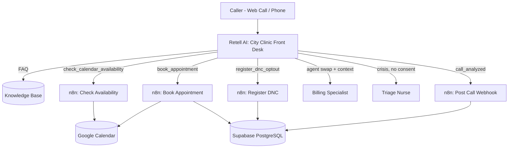
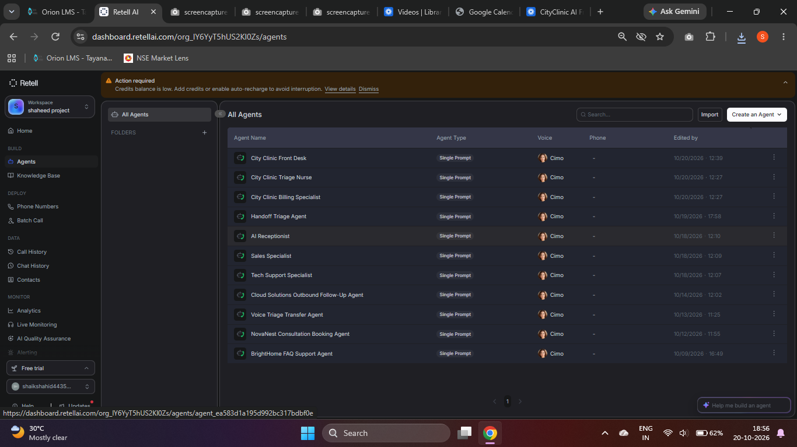
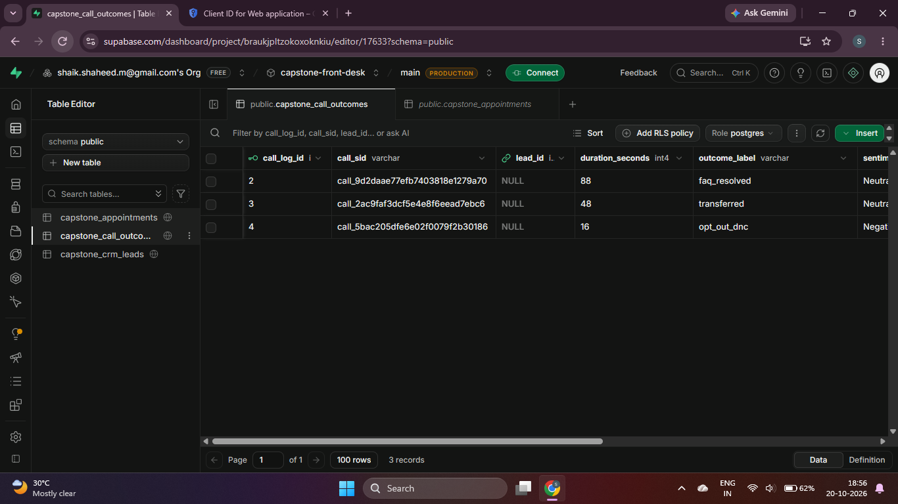
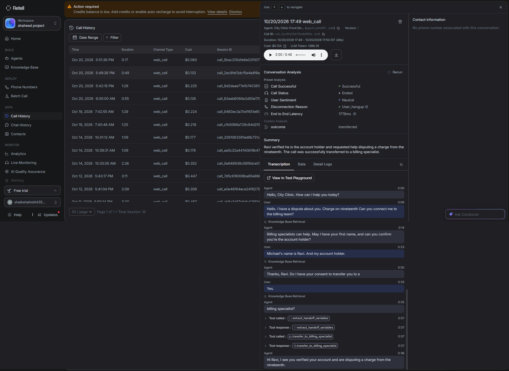
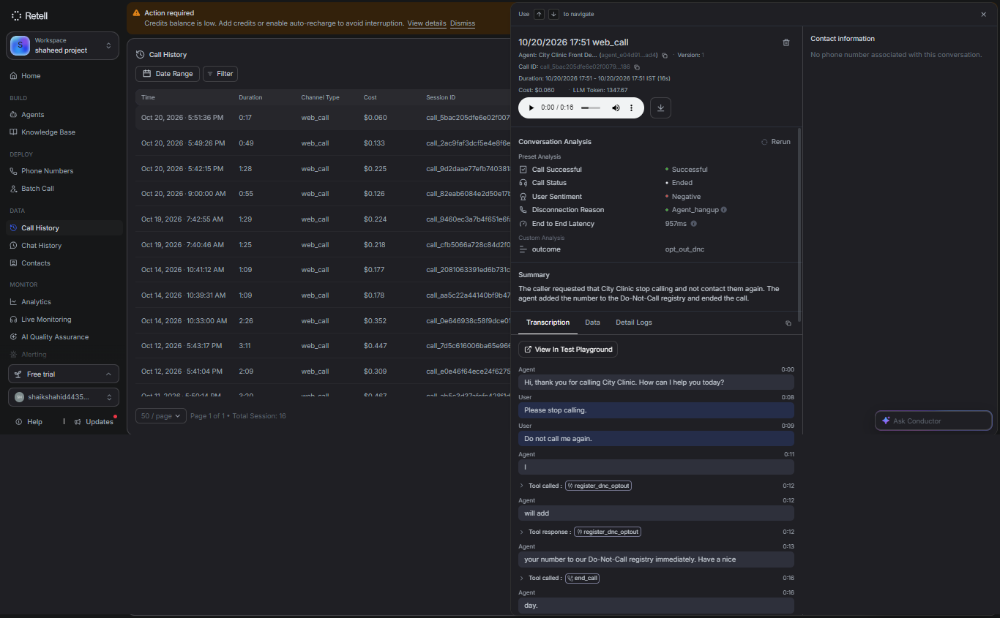
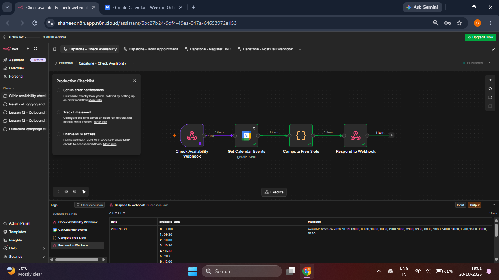
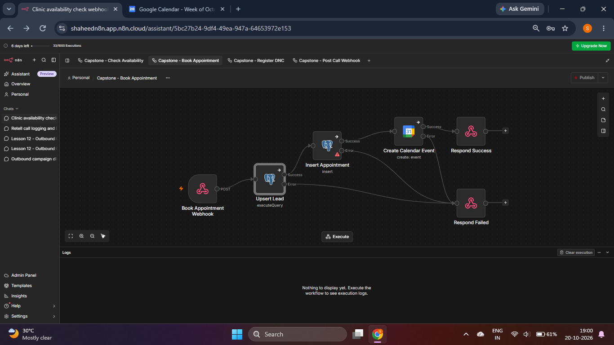
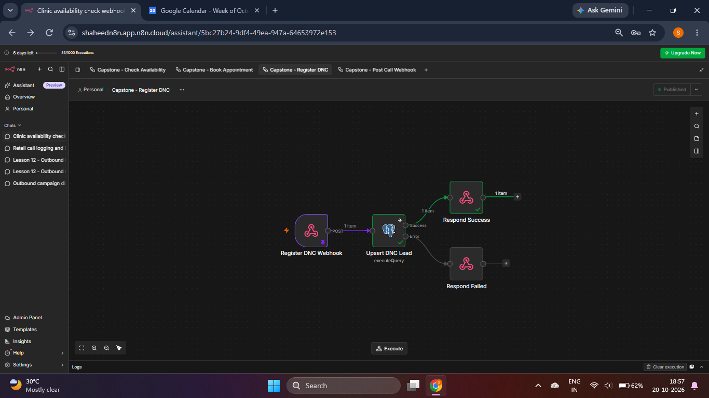
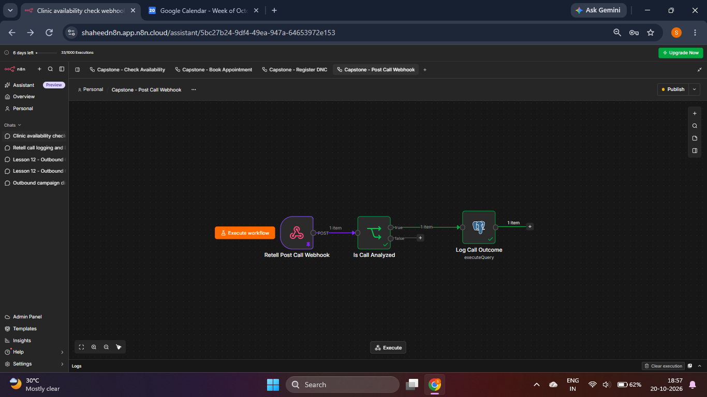

<div align="center">


<a href="https://github.com/shaikshahid777/city-clinic-ai-voice-front-desk-capstone">
  
</a>

<br/>

[](https://www.retellai.com/)
[](https://n8n.io/)
[](https://supabase.com/)
[](https://calendar.google.com/)
[](https://www.postgresql.org/)


<br/>

<a href="https://www.loom.com/share/63fca9a9bcb541cfac3035be2508d572"></a>
<a href="#-architecture"></a>
<a href="#-test-results"></a>
<a href="#-quick-start"></a>

</div>

---

## 📌 Overview

**AI Voice Front Desk** is a portfolio capstone: a unified, production-style **inbound voice agent** for a fictional *City Clinic*. It replaces "press 1, press 2" phone trees with a conversational agent that can **triage the call, answer FAQs, book appointments, sync a CRM, hand off to specialists with context, honour compliance rules, and log analytics**.

> 🎯 Goal: show job-ready voice-automation skills: API latency handling, state management, compliance boundaries and real integrations.

## ✨ Features

| | Feature | How it works |
|---|---|---|
| 🧭 | **Triage and intent parsing** | Front Desk agent routes to FAQ, booking, billing or emergency paths |
| 📚 | **FAQ from knowledge base** | Answers only from the `City Clinic FAQ` KB, never invents facts |
| 📅 | **Real-time booking** | `check_calendar_availability` and `book_appointment` call n8n, Google Calendar and Postgres |
| 🔒 | **Double-booking protection** | `UNIQUE (booking_date, booking_time)` plus insert-before-calendar ordering |
| 🔁 | **Context-aware handoff** | `extract_handoff_variables` then agent swap, Billing agent greets by name without re-verifying |
| 🚨 | **Crisis gate** | Emergency words trigger the 911 message and transfer to the nurse without consent |
| 🚫 | **Do-Not-Call gate** | "Stop calling" sets `dnc_status = TRUE` and ends the call |
| 📊 | **Post-call analytics** | Summary, sentiment and `outcome` selector logged to `capstone_call_outcomes` |

## 🏗 Architecture



More diagrams: [`docs/architecture.md`](docs/architecture.md)

## 🧰 Tech Stack

| Layer | Tool |
|---|---|
| Voice agents | Retell AI (3 agents, custom functions, KB, post-call analysis) |
| Automation / API | n8n Cloud (4 published webhook workflows) |
| Database / CRM | Supabase PostgreSQL |
| Scheduling | Google Calendar API (OAuth2) |
| Telephony | Retell Web Call (Twilio-ready) |

## 🗂 Repository Structure

```text
city-clinic-ai-voice-front-desk-capstone/
├── README.md
├── LICENSE
├── .env.example
├── database/
│   ├── schema.sql              # 3 tables + indexes + unique slot constraint
│   └── queries.sql             # SQL used by the n8n workflows
├── retell/
│   ├── prompts/                # Front Desk, Billing, Triage Nurse prompts
│   ├── tools/                  # custom function + transfer definitions (JSON)
│   ├── knowledge_base/         # City Clinic FAQ text
│   └── post_call_analysis.json # outcome selector + webhook config
├── n8n/
│   ├── workflows/              # exported workflow JSON files
│   └── sample_payloads/        # example Retell request bodies
├── docs/
│   ├── architecture.md
│   ├── setup-guide.md
│   ├── test-cases.md
│   └── challenges-and-limitations.md
└── assets/screenshots/         # evidence screenshots
```

## 🗄 Database Schema

| Table | Purpose |
|---|---|
| `capstone_crm_leads` | Caller identity, contact info, `dnc_status` |
| `capstone_appointments` | Booked slots, unique per date and time |
| `capstone_call_outcomes` | Call id, duration, outcome, sentiment, summary |

## 🔄 n8n Workflows

| Workflow | Endpoint | What it does |
|---|---|---|
| Check Availability | `POST /webhook/check-availability` | Reads Google Calendar and returns free 30-min slots (09:00-17:00) |
| Book Appointment | `POST /webhook/book-appointment` | Upserts lead, inserts appointment, creates calendar event |
| Register DNC | `POST /webhook/register-dnc` | Upserts lead with `dnc_status = TRUE` |
| Post Call Webhook | `POST /webhook/retell-postcall` | Logs `call_analyzed` data into `capstone_call_outcomes` |

## ✅ Test Results

| ID | Scenario | Result |
|---|---|---|
| TC-001 | Calendar availability check | ✅ Pass |
| TC-002 | Booking + CRM sync (live n8n run) | ✅ Pass |
| TC-002b | Duplicate slot rejected by DB | ✅ Pass |
| TC-003 | Billing transfer with context | ✅ Pass |
| TC-004 | Voice opt-out and DNC | ✅ Pass |
| TC-005 | Post-call webhook logging | ✅ Pass |
| TC-006 | FAQ from knowledge base | ✅ Pass |

Details: [`docs/test-cases.md`](docs/test-cases.md)

## 📸 Screenshots

| Retell agents | Supabase call outcomes |
|---|---|
|  |  |

| Billing transfer call | Opt-out (DNC) call |
|---|---|
|  |  |

<details>
<summary><b>🔧 n8n workflow screenshots</b></summary>

| Check Availability | Book Appointment |
|---|---|
|  |  |

| Register DNC | Post Call Webhook |
|---|---|
|  |  |

</details>

## 🚀 Quick Start

1. Run [`database/schema.sql`](database/schema.sql) in the Supabase SQL Editor.
2. Create Postgres and Google Calendar credentials in n8n, import the workflows and **Publish** all four.
3. Create the 3 Retell agents with the prompts in [`retell/prompts`](retell/prompts), add the functions from [`retell/tools`](retell/tools) using your n8n production URLs.
4. Create and attach the knowledge base, add the `outcome` selector, set the webhook on the Front Desk agent.
5. Run a Web Call and verify Supabase, Google Calendar and n8n Executions.

Full guide: [`docs/setup-guide.md`](docs/setup-guide.md)

## ⚠️ Challenges and Limitations

- Supabase SSL certificate rejected by n8n, fixed with *Ignore SSL Issues* on the credential.
- Retell agent swap cannot pass variables directly, solved with `extract_handoff_variables`.
- Transfer latency cannot be measured in Retell, webhook signature verification is not yet implemented.

Full list and future enhancements: [`docs/challenges-and-limitations.md`](docs/challenges-and-limitations.md)

## 👤 Author

**Shaik Shahid**
[](https://github.com/shaikshahid777)

<div align="center">


</div>
