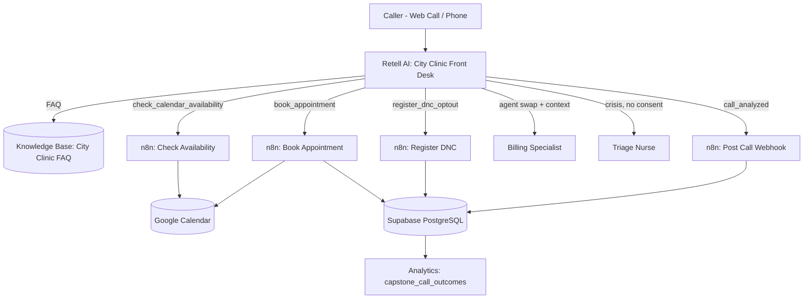
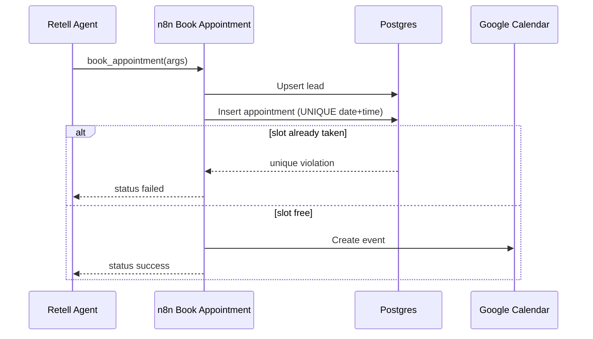

# Architecture

## Booking flow (double-booking safe)

## Key design decisions

- **DB before calendar:** the appointment row is inserted first, so a duplicate slot fails before any calendar event exists.
- **Agent speaks only after tool result:** the agent never says "confirmed" until the tool returns `success`.
- **One post-call event per call:** only the Front Desk agent has the webhook; Billing and Nurse do not.
- **Context handoff:** `extract_handoff_variables` stores caller context before the agent swap.
